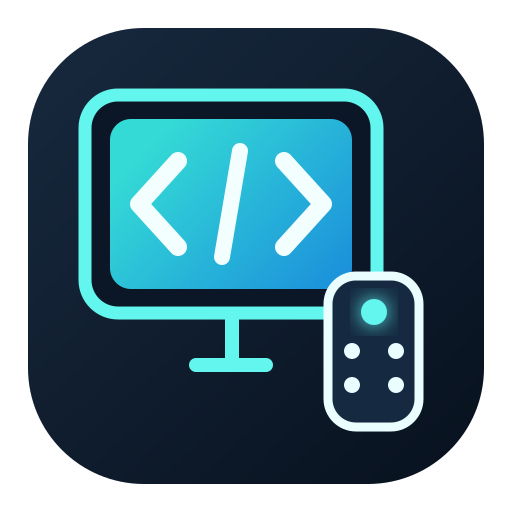

# ADB FullTV

  

**ADB FullTV** is a Home Assistant custom integration for Android TV and Google TV devices. It combines Android TV Remote v2 with local ADB telemetry in one clean device: remote control, friendly app sources, YouTube metadata, screenshots, on-screen notifications, media controls and precise volume control.

> This project is independent and is not affiliated with Google, Android, TCL, YouTube, Netflix, or any streaming provider.

## Features

- One unified `media_player` for Android TV / Google TV
- Friendly sources: YouTube, Netflix, Prime Video, Disney+, Spotify, Apple TV+ and more
- Remote control entity with navigation, media and power commands
- Current app, title, artist/channel, duration and position metadata
- App icon fallback and Cast artwork support
- Live PNG screen capture through ADB
- On-screen notification entity with an ADB fallback
- Volume and mute control, including optional direct ADB volume
- English and Turkish interface translations
- Startup-safe background connection and telemetry tasks

## Requirements

- Home Assistant `2026.11.0` or newer
- An Android TV / Google TV device reachable on your local network
- Android TV Remote pairing enabled for navigation and power controls
- Optional: ADB / Network Debugging enabled on TCP port `5555` for media metadata, screenshots, notification fallback and exact volume control

## Installation with HACS

Until the repository is listed in the default HACS catalogue:

1. Open **HACS → Integrations → ⋮ → Custom repositories**.
2. Add `https://github.com/Azadglr/adb-fulltv` as type **Integration**.
3. Search for **ADB FullTV** and install it.
4. Restart Home Assistant.
5. Go to **Settings → Devices & services → Add integration → ADB FullTV**.

When the repository is public, this direct Home Assistant link can add it to HACS:

## Manual installation

Copy `custom_components/adb_fulltv` into your Home Assistant `config/custom_components` directory, then restart Home Assistant.

## Entity layout

| Entity | Purpose |
| --- | --- |
| `media_player.adb_fulltv` | Main TV, media, sources, volume and power |
| `remote.adb_fulltv_remote` | Navigation and remote commands |
| `image.adb_fulltv_screen` | Current TV screen as a PNG image |
| `notify.adb_fulltv_notification` | On-screen message service |

## Security

Keep ADB available only on your trusted local network. Never expose TCP port `5555` directly to the internet.

## Türkçe

**ADB FullTV**, Android TV ve Google TV cihazları için tek noktadan kontrol sağlayan bir Home Assistant entegrasyonudur. Kumanda, uygulama kaynak seçimi, YouTube başlık/kanal bilgileri, ekran görüntüsü, ekran bildirimi, medya kontrolleri ve ses yönetimini tek cihazda birleştirir.

### HACS kurulumu

Depo HACS’in varsayılan listesine eklenene kadar:

1. **HACS → Entegrasyonlar → ⋮ → Özel depolar** bölümünü açın.
2. `https://github.com/Azadglr/adb-fulltv` adresini **Integration** türüyle ekleyin.
3. **ADB FullTV** aratıp yükleyin.
4. Home Assistant’ı yeniden başlatın.
5. **Ayarlar → Cihazlar ve servisler → Entegrasyon ekle → ADB FullTV** yolunu izleyin.

ADB / Ağ hata ayıklamasını yalnız güvenilir yerel ağınızda etkin tutun. `5555` numaralı bağlantı noktasını internete açmayın.

## Contributing

Bug reports, device compatibility reports and pull requests are welcome. Please avoid committing private addresses, pairing material, ADB keys, screenshots or Home Assistant storage files.
